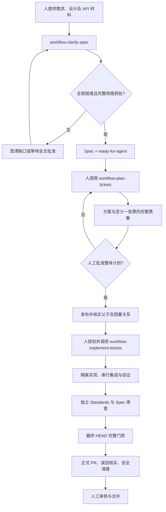
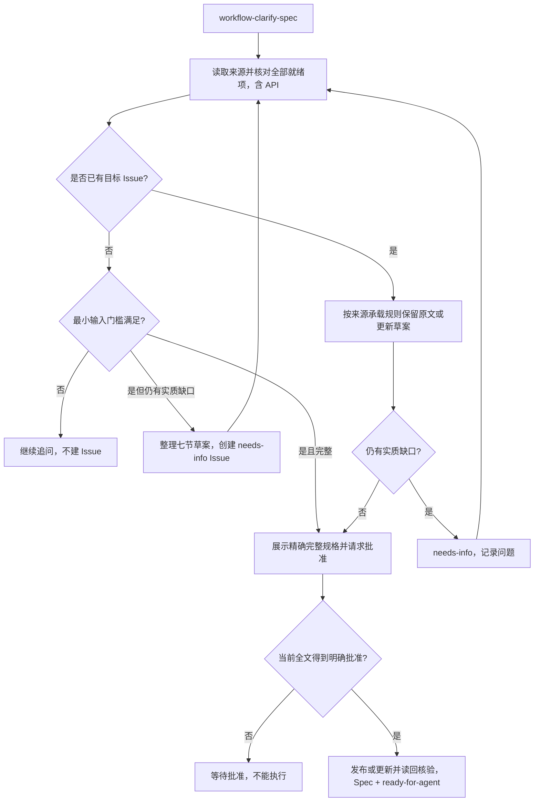
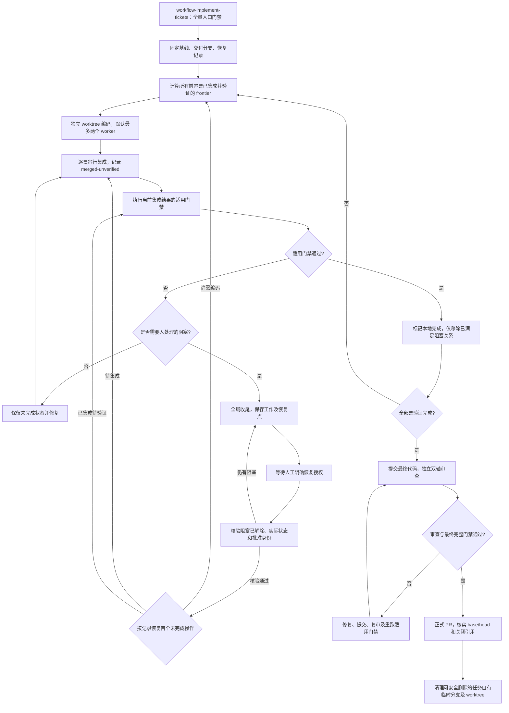

# 前端 AI 工作流手册

本手册描述模板当前可执行流程。目标是让团队把需求、设计和 API 转换为经人工批准的规格及票集，再由 Codex 实现、验证、审查，交付正式 PR。人负责需求决策、阶段授权及最终合并；代理负责澄清、记录和有证据的执行。三个入口均需要人工显式调用。

[接入简介](workflow-onboarding.md)说明安装与迁移。[同步清单](workflow-sync-audit.md)记录本轮冲突处理。[来源说明](workflow-sharing-design.md)区分历史设计与当前协议。

## 整体流程

规划批准仅授权发布票集；不能推断为实现授权。标签也不能替代对应版本的批准记录。模板没有独立部署或 smoke skill，部署后冒烟由实际项目另行明确范围和授权。

## 第一阶段：澄清并批准规格

入口：`$workflow-clarify-spec`。输入可以是口述、已有 Issue、Jira/Confluence 内容、设计和原型，以及 API 文档。记录真实来源及精确版本或抓取时间；不能把猜测写成需求。

在这一阶段补充并确认 API：端点、方法、输入输出和 schema、鉴权、错误与边界；涉及写入还需成功、失败、重试及重复提交行为。后端未就绪时确认 mock/fixture 策略。**API 契约缺口属于规格缺口，在澄清阶段解决；规划阶段复用已确认契约。** 依赖是否可运行与输入是否完整分别判断。

UI 的交互、布局、主题分别确认。可使用精确批准的设计，或项目规则允许且精确定位的既有模式。新增项目不能凭空套用旧项目设计；缺失维度应给出 2–3 个实质不同方案供选择。还需明确适用的响应式、加载/空/错/禁用/成功状态、键盘可访问性、文案与资产、视觉偏差和冲突负责人。

无目标 Issue 时，先进行实质澄清；不足最小输入门槛继续追问。达到门槛但仍有实质缺口时，可创建带七节草案的 `needs-info` Issue。信息完整的新需求先批准全文，再建 Issue。工作流创建的 Issue 不使用 `needs-triage`；缺口解决而全文尚未批准时移除 `needs-info` 并等待批准。已有外部 Issue 在重新评估或等待批准时使用 `needs-triage`，不覆盖其原始需求，按 carrier 协议维护澄清记录及 Agent Brief。

全文批准绑定精确标题、正文、marker 与内容哈希；沉默和单条问题回复都不是批准。补材料后重新检查全部适用就绪项，而非只补上一个空缺。真正需要人实现的需求进入 `ready-for-human`，决定不处理的进入 `wontfix`。

## 第二阶段：批准并发布完整票集

入口：人显式调用 `$workflow-plan-tickets`，输入当前 `Spec + ready-for-agent` 及其有效全文批准记录。先检查来源、carrier、规格身份与当前内容一致；批准漂移不能沿用。

规划复用第一阶段已确认的 API、设计和验收边界，明确关键技术取舍并形成**至少一张实现票**。每张票描述可独立验证的结果、验收标准、父规格及依赖。完整方案和所有票一起获得明确批准后，才发布并核实 GitHub 原生父子关系和阻塞关系。只发布了一部分不算完整计划，不能把任意票子集交给实现阶段。

规划发现实质契约或需求缺口时，回到澄清和重新批准；不在规划内悄悄改写已批准规格。发布结果不确定时先读回现有远程对象，避免重复创建。

## 第三阶段：实现、审查和交付

入口：人显式授权并调用 `$workflow-implement-tickets`，输入父规格和完整批准票集。核对当前规格、全部票、原生关系、计划发布完整性和实现授权，先保存固定基线 SHA、交付分支和持久执行记录，再分发工作。

独立票默认最多两个实现 worker，按宿主能力和共享资源冲突减少并发；每个 worker 使用隔离 worktree，不能直接更新共享记录或 tracker。集成和验证始终逐个进行，只有在当前交付分支验证成功后才推进依赖。Issue 保持开启，不能用本地完成状态代替人工合并后的关闭。

全量完成后，独立 Standards 和 Spec 审查覆盖固定基线到当前 HEAD。有效问题修复并提交后复审影响范围；完整门禁必须覆盖最终提交。失败、超时或环境阻塞都不是通过。只有审查与门禁有效覆盖最终 HEAD，才能推送并创建或更新正式 PR；核实父规格和每张票的关闭引用，不提前关 Issue，也不自动监控 CI。

## 暂停、纠错与恢复

需要人处理的阻塞触发整个协调器收尾：停止新分发及后续合并，保存进行中的工作，记录证据和恢复点。保留主状态并加 `waiting-for-human`；恢复需要明确人工授权及重新核验。普通依赖等待、后端暂不可用但已有有效 fixture 方案，不自动构成人工阻塞。

规格纠错沿用模板现有协议：已拆票后，仅当原始可确认需求被记录错误、且意图、范围和依赖均不扩展时，才可在批准精确修订版本后更新同一 Issue（外部 Agent Brief 发布替代版本并保留旧评论），刷新关联内容身份和批准记录，重核票集及影响范围。新需求或改变原有意图、范围、依赖的需求，即使没有增加功能范围，也应建立关联新 Issue；不能借纠错扩展旧授权。实际操作以 [version 协议](../.agents/skills/common/version.md)为准。

恢复数据保存在主项目忽略的 `.workflow-local/`，遵循 [records](../.agents/skills/common/records.md) 和 [recovery](../.agents/skills/workflow-implement-tickets/references/recovery.md)。恢复前核对 Git、远程对象和已记录身份；不确定的写入先读回，不盲目重试。复制模板时不得带走旧运行状态。

## PR 后安全清理

PR 已核实后，自动清理已集成、干净且属于当前任务的临时 worker/fix worktree 与本地分支。任务创建时就记录所有权；重放提交需按 cleanup 协议提供精确等价证据。禁止强制删除、不删除交付分支或远程分支，不确定或未完成工作保留并注明原因。清理部分失败与 PR 交付结果分别报告。详见 [cleanup](../.agents/skills/workflow-implement-tickets/references/cleanup.md)。

## 标签和规则入口

| 类型             | 标签              | 含义                               |
| ---------------- | ----------------- | ---------------------------------- |
| 主状态，最多一个 | needs-triage      | 已存在的外部 Issue 待评估或批准    |
| 主状态，最多一个 | needs-info        | 仍有实质信息缺口                   |
| 主状态，最多一个 | ready-for-agent   | 全部就绪、全文已批准且适合代理实现 |
| 主状态，最多一个 | ready-for-human   | 就绪但需人实现或判断               |
| 主状态，最多一个 | wontfix           | 评估后决定不处理；不是暂停标签     |
| 类型             | Spec              | 当前已批准的父规格；实现票不得使用 |
| 辅助             | waiting-for-human | 执行阻塞，保留主状态并记录恢复点   |

完整规则：[就绪标准](agents/definition-of-ready.md)、[标签](agents/triage-labels.md)、[tracker](agents/issue-tracker.md)、[验证](agents/verification.md)、[skills 来源和边界](agents/skills.md)。本手册不另创标签、记录格式或隐式授权；维护时必须与 skill 和配置同步。
